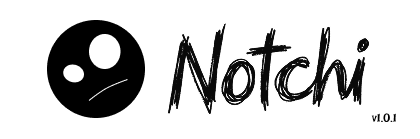

  

  <a href="README.md">English</a> | <a href="READMEindo.md">Bahasa Indonesia</a>

## Overview

Notchi Mobile is the native Android companion app for [Notchi](https://github.com/risuunava/Notchi), connecting your smartphone with your Windows PC over a local Wi-Fi network. Built with Flutter, it delivers two-way file sharing, instant PC media controls, live hardware monitoring, and quick notes with a clean, monochrome aesthetic inspired by Dynamic Island.

## System Requirements

| Component | Minimum | Recommended |
| :--- | :--- | :--- |
| Operating system | Android 8.0 Oreo (API level 26) | Android 11.0 (API level 30) or later |
| Architecture | ARM64-v8a, armeabi-v7a, x86_64 | ARM64-v8a |
| Memory | 2 GB RAM | 4 GB RAM or more |
| Storage | 100 MB free space | 1 GB or more free space for file downloads |
| Camera | Required for QR pairing | Standard resolution camera with autofocus |
| Connectivity | Wi-Fi connected to the same local network as the PC | 5 GHz or Wi-Fi 6 for faster file transfer |

## Installation

Download the latest `app-release.apk` from the [Releases](https://github.com/risuunava/notchi-mobile/releases/latest) page, transfer it to your device (or download directly on your phone), and install it. Allow camera permissions when prompted to enable quick QR pairing.

## Features

| Feature | Description |
| :--- | :--- |
| Quick QR pairing | Scan the QR code displayed on Notchi Windows to establish an encrypted local session within seconds. |
| Manual connection fallback | Connect manually by entering the PC's local IP address, port, and session token. |
| Two-way Drop Shelf | Transfer files and text between PC and mobile seamlessly over LAN without uploading to any external cloud. |
| Drag to Mobile (PC → Phone) | Dragging files to the "Share to Mobile" drop zone in Notchi Windows automatically pushes them to your phone's `Download` folder. |
| Direct file opening | Open downloaded files directly using default Android apps (PDF readers, media players, image viewers) via Android FileProvider. |
| System share sheet | Send files or text directly from other Android apps (Gallery, Files, Browser) to Notchi PC using Android's native Share menu. |
| Shelf history & filter | Review transfer history with distinct download/upload icons and filter by *All*, *From PC*, or *To PC*. |
| Media playback control | Play, pause, skip tracks, and adjust the PC system volume directly from your phone. |
| PC hardware dashboard | Displays live CPU usage, RAM utilization, and battery/power status of your PC in real time. |
| Quick notes | Write short notes on mobile and instantly push them to the Notchi Windows Notes window. |
| Clean monochrome UI | Modern dark and light theme following a clean black-and-white minimalist design. |
| Bilingual interface | Full localization support for both English and Bahasa Indonesia. |

## Latest Update

| Version | Released | Status |
| :--- | :--- | :--- |
| 1.0.0 | November 10, 2026 | Latest stable |

Version 1.0.0 is the initial public release of Notchi Mobile. It brings two-way file and text transfer with Notchi Windows, direct file opening on Android, transfer history filtering, live PC media and system control, quick notes, and camera-based QR pairing. Full release details are available on the [Releases](https://github.com/risuunava/notchi-mobile/releases) page.

## Contributing

Contributions are welcome, including bug reports, feature suggestions, and pull requests. If you would like to contribute or report an issue, please open an issue in this repository.

  

## Contact

Developer: **risuunava**

  
  
  
  

## License

Notchi Mobile is released under the Apache License 2.0. See [LICENSE](LICENSE) for details.
