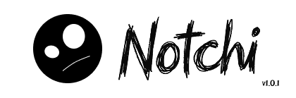

  

  <a href="README.md">English</a> | <a href="READMEindo.md">Bahasa Indonesia</a>

## Ringkasan

Notchi Mobile adalah aplikasi pendamping (*companion app*) Android native untuk [Notchi](https://github.com/risuunava/Notchi), yang menghubungkan smartphone Anda dengan PC Windows melalui jaringan Wi-Fi lokal. Dibangun dengan Flutter, aplikasi ini menyediakan transfer file dua arah, kontrol pemutar media PC, pemantau hardware live, dan catatan cepat dengan gaya desain monokrom hitam-putih yang bersih terinspirasi dari Dynamic Island.

## Spesifikasi Sistem

| Komponen | Minimum | Disarankan |
| :--- | :--- | :--- |
| Sistem operasi | Android 8.0 Oreo (API level 26) | Android 11.0 (API level 30) atau lebih baru |
| Arsitektur | ARM64-v8a, armeabi-v7a, x86_64 | ARM64-v8a |
| Memori | RAM 2 GB | RAM 4 GB atau lebih |
| Penyimpanan | 100 MB ruang kosong | 1 GB atau lebih untuk unduhan file |
| Kamera | Diperlukan untuk scan QR pairing | Kamera beresolusi standar dengan autofokus |
| Konektivitas | Wi-Fi terhubung ke jaringan lokal yang sama dengan PC | Wi-Fi 5 GHz atau Wi-Fi 6 untuk transfer file lebih cepat |

## Pemasangan

Unduh file `app-release.apk` terbaru dari halaman [Releases](https://github.com/risuunava/notchi-mobile/releases/latest) lalu pasang di perangkat Android Anda. Berikan izin akses kamera saat diminta agar dapat melakukan pairing QR code dengan cepat.

## Fitur

| Fitur | Deskripsi |
| :--- | :--- |
| Pairing QR cepat | Pindai kode QR yang tampil di Notchi Windows untuk menghubungkan perangkat dalam hitungan detik. |
| Koneksi manual | Opsi menghubungkan secara manual menggunakan alamat IP lokal, port, dan token sesi PC. |
| Drop Shelf dua arah | Kirim file dan teks antara PC dan HP secara instan melalui LAN tanpa melalui cloud luar. |
| Drag ke HP (PC → HP) | Drag file ke zona "Share to Mobile" di Notchi Windows untuk langsung mengirim dan menyimpannya di folder `Download` HP. |
| Buka file langsung | File yang diterima dapat langsung dibuka menggunakan aplikasi bawaan Android (PDF reader, pemutar video, galeri) via FileProvider resmi. |
| Integrasi Share Sheet | Kirim file atau teks langsung dari aplikasi Android lain (Galeri, Pengelola File, Browser) ke Notchi PC lewat menu Share bawaan. |
| Riwayat & filter shelf | Pantau riwayat transfer dengan ikon download/upload yang jelas serta opsi filter *Semua*, *Dari PC*, atau *Ke PC*. |
| Kontrol pemutar media | Putar, jeda, lewati lagu, dan atur volume sistem PC langsung dari ponsel Anda. |
| Dashboard hardware PC | Menampilkan penggunaan CPU, utilisasi RAM, dan status baterai/daya PC secara real-time. |
| Catatan cepat (Notes) | Tulis catatan singkat di ponsel dan kirim seketika ke jendela Catatan Notchi Windows. |
| Desain monokrom bersih | Antarmuka minimalis bertema hitam-putih yang bersih dan responsif. |
| Antarmuka bilingual | Dukungan penuh untuk Bahasa Indonesia dan English. |

## Pembaruan Terbaru

| Versi | Tanggal Rilis | Status |
| :--- | :--- | :--- |
| 1.0.0 | 10 November 2026 | Versi stabil terbaru |

Versi 1.0.0 merupakan rilis publik perdana Notchi Mobile. Versi ini menghadirkan transfer file dan teks dua arah dengan Notchi Windows, pembuka file langsung di Android, filter riwayat transfer, kontrol media dan monitor hardware PC live, catatan cepat, dan pairing QR berbasis kamera. Catatan rilis lengkap tersedia di halaman [Releases](https://github.com/risuunava/notchi-mobile/releases).

## Kontribusi

Kontribusi selalu terbuka, termasuk laporan bug, saran fitur, serta pull request. Jika Anda ingin berkontribusi atau menemukan masalah, silakan buka issue di repositori ini.

  

## Kontak

Pengembang: **risuunava**

  
  
  
  

## Lisensi

Notchi Mobile dirilis di bawah Lisensi Apache 2.0. Lihat [LICENSE](LICENSE) untuk rincian selengkapnya.

